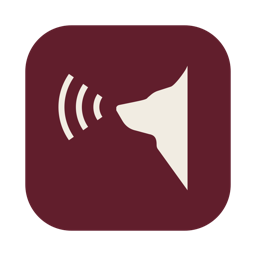

<p align="center">
  
</p>

<h1 align="center">Bkdict</h1>

<p align="center">
  Ditado por voz para macOS e Windows, da BKDG. Segure uma tecla, fale e solte: o texto é transcrito, ajustado e inserido na posição do cursor, em qualquer app.<br>
  A transcrição e a IA rodam <b>neste computador</b>, sem custo, ou na <b>sua conta</b>, com a sua chave de API.
</p>

---

## O que é

O Bkdict transcreve o que você fala em qualquer app (Slack, email, Notion, navegador, editor de código), remove vícios de fala, corrige a pontuação e cola o resultado onde o cursor estiver. O clipboard é preservado.

Você escolhe onde cada parte roda:

- **Neste computador:** transcrição com [whisper.cpp](https://github.com/ggml-org/whisper.cpp) e IA com [Ollama](https://ollama.com). Nada sai da máquina.
- **Na sua conta:** chave de API da OpenAI, Anthropic (Claude), Groq, Google Gemini ou xAI (Grok).

## Recursos

- **Segure e fale:** segure `Fn` (ou o atalho que você definir), fale e solte. O texto é colado no app em foco.
- **Mãos livres:** `Fn + Espaço` começa a gravar sem segurar a tecla; o mesmo atalho para.
- **Modo comando:** selecione um texto, segure `Fn + ⌃` e diga a instrução ("traduz para inglês", "deixa mais formal").
- **Transforms:** reescritas acionadas por atalho (formal, resumo, tópicos, email, tradução). Crie as suas, com sugestões geradas pela IA, ou aplique uma automaticamente em todo ditado.
- **Atalhos:** até 2 por ação. Pode ser uma tecla F, uma combinação, um modificador sozinho (⇧ direito, Fn) ou um botão extra do mouse.
- **Dicionário e correções:** nomes, siglas e termos técnicos que a transcrição precisa escrever certo.
- **Snippets:** uma frase-gatilho ("meu email") insere um texto fixo.
- **Ajuste com IA:** remove "é…", "tipo" e repetições, e corrige a pontuação.
- **Histórico** de ditados, estatísticas e tema claro, escuro ou do sistema.

## Modelos

Na aba **Modelos**, cada parte tem duas opções: *neste computador* ou *na sua conta*.

| | Neste computador (sem custo) | Na sua conta (chave de API) |
|---|---|---|
| **Transcrição** | Whisper: Base, Small, Medium, Large v3 e Large v3 Turbo, baixados dentro do app | OpenAI (`gpt-4o-transcribe`…) ou Groq (`whisper-large-v3-turbo`…) |
| **IA** (ajuste, comando, transforms) | Ollama: Qwen 2.5, Llama 3.x, Mistral, Gemma 2, Phi-3… | OpenAI, Anthropic, Groq, Gemini ou xAI |

No macOS, as chaves de API ficam no **Keychain**; no Windows, no **Gerenciador de Credenciais**. Nunca em arquivo.

## Atalhos (macOS)

| Ação | Padrão |
|---|---|
| Ditar (segurar) | `Fn` |
| Mãos livres | `Fn + Espaço` |
| Modo comando (segurar) | `Fn + ⌃` |
| Transform 1…9 | `Fn + 1…9` (ou o atalho de cada transform) |
| Colar / copiar a última transcrição | `⌃⌘V` / `⌃⌘C` |
| Cancelar | `Esc` |

Todos podem ser trocados em **Ajustes → Atalhos**. Os atalhos do Windows estão no [README do Windows](windows/README.md).

## Instalar no macOS

Requisitos: macOS 14 ou superior (Intel ou Apple Silicon).

1. Abra o `Bkdict-x.y.z.dmg` e arraste o **Bkdict** para **Aplicativos**.
2. O app é assinado ad-hoc, sem certificado da Apple, então o macOS bloqueia a primeira abertura. Vá em Ajustes do Sistema → Privacidade e Segurança → **Abrir Mesmo Assim**, ou rode `xattr -dr com.apple.quarantine /Applications/Bkdict.app`.
3. Abra o Bkdict. No primeiro uso, ele instala sozinho o que precisa para rodar neste Mac, sem Terminal nem Homebrew:
   - o **whisper** (transcrição, cerca de 5 MB);
   - o **Ollama** (IA local, cerca de 175 MB).

   Os dois ficam em `~/Library/Application Support/Bkdict`. Quem já tem o whisper-cpp pelo Homebrew ou o Ollama.app instalados usa os que já existem.

### Primeiro uso

1. Permita o Bkdict em **Microfone** e **Acessibilidade** (Ajustes do Sistema → Privacidade e Segurança).
2. Em **Modelos**, escolha e baixe um modelo de transcrição (recomendado: *Large v3 Turbo (comprimido)*) ou cole uma chave de API. Para IA local, baixe também um modelo do Ollama na mesma tela.
3. Se usar `Fn`: em Ajustes do Sistema → Teclado, deixe "Ao pressionar 🌐" como **Não fazer nada**.
4. Segure `Fn` e fale.

## Windows

A versão para Windows 10 e 11 fica em [`windows/`](windows/README.md), em C# / WPF, com os mesmos recursos e a mesma identidade. Por enquanto, ela é compilada a partir do código.

## Como funciona

```
tecla segurada ─▶ AVAudioEngine (16 kHz) ─▶ whisper-server local / API de transcrição
                                                     │
                     colar no app em foco ◀─ dicionário, snippets ◀─ ajuste / transform com IA
```

- App nativo em **Swift + SwiftUI**, sem Electron. Os atalhos usam um `CGEventTap`, e o texto entra via clipboard + `⌘V`, com o clipboard restaurado logo depois.
- A transcrição local roda o `whisper-server` do whisper.cpp em segundo plano, com o modelo carregado para responder rápido. A IA local roda o `ollama serve`. O app inicia os dois e encerra ao sair; um Ollama que já estava rodando antes fica como estava.
- Histórico, dicionário e transforms ficam em `~/Library/Application Support/Bkdict`.

## Identidade visual

O app segue o design system da BKDG:

- **Cores:** Tinta `#0A0A0A`, Osso `#F1ECE2` e Bordô `#611E2C`. No modo escuro, o acento é o Bordô claro `#B33751`, porque o Bordô cheio some sobre Tinta (1,63:1).
- **Fontes:** Zilla Slab nos títulos, IBM Plex Sans no texto e IBM Plex Mono nos rótulos em caixa-alta. Ficam em `Resources/Fonts`, com as licenças OFL, e entram no app pelo `ATSApplicationFontsPath` do `Info.plist`.
- **Formas:** cantos de no máximo 4pt, superfícies chapadas, sem gradiente, brilho ou sombra.
- **Símbolo:** o Observador da BKDG, com três ondas de voz. O cão vem do vetor oficial (`brand-mark.svg`), sem redesenho. No código, ele é a forma `BrandMark` em `Sources/Bkdict/UI/Theme.swift`; os tokens de cor e fonte estão no mesmo arquivo.

| Arquivo | O que é |
|---|---|
| `Resources/Icons/app-icon.svg` | Fonte do ícone do macOS |
| `Resources/Icons/app-icon-windows.svg` | Fonte do ícone do Windows (sem a margem que o macOS aplica) |
| `Resources/Icons/menubar-icon.svg` | Fonte do ícone da barra de menus (template) |
| `Resources/AppIcon-1024.png`, `AppIcon-windows-1024.png`, `MenuBarIcon*.png` | Gerados a partir dos SVGs |
| `Resources/dmg-background.tiff` | Fundo do instalador `.dmg` |

Para regenerar depois de mudar um SVG ou o fundo do `.dmg`:

```sh
npm i --no-save sharp && node scripts/gen-icons.mjs
swift scripts/gen-dmg-background.swift
```

## Desenvolvimento

Requisitos: Xcode 16+ (Swift 5.10+).

```sh
swift build          # compila
./build.sh           # gera dist/Bkdict.app
./build.sh --install # copia para /Applications
./build.sh --release # app universal (Intel + Apple Silicon) em dist/Bkdict-x.y.z.zip e .dmg (requer: brew install create-dmg)
```

O identificador `co.bkdg.bkdict` é fixo para o macOS manter as permissões de Microfone e Acessibilidade entre builds.

### Publicar uma versão

```sh
# 1. Suba CFBundleShortVersionString (ex.: 0.2.0) e CFBundleVersion (inteiro, sempre maior) em Resources/Info.plist
# 2. Publique (requer create-dmg, .NET 10 SDK e o gh logado na cadu-web)
scripts/release.sh "O que mudou nesta versão"
```

O script gera o DMG e o ZIP do Mac, o ZIP do Windows (com o .NET embutido), o `appcast.xml` assinado, e cria a release `vX.Y.Z` em `cadu-web/bkdict`.

**Atualização automática:**

- **No Mac**, o [Sparkle](https://sparkle-project.org) consulta o `appcast.xml` da release mais recente. Ele instala a versão nova quando a pessoa aceita; dá também para procurar manualmente em **Procurar atualizações…**, no menu do app.
- **No Windows**, o app consulta a release mais recente ao abrir e, se houver versão nova, avisa na bandeja com o link para baixar.

Cada atualização do Mac é assinada com uma chave EdDSA. A pública está no `Info.plist` (`SUPublicEDKey`); a privada fica no Keychain de quem publica, na conta `bkdict`. **Sem a chave privada, nenhum app instalado aceita uma atualização nova.** Faça backup dela com `.build/artifacts/sparkle/Sparkle/bin/generate_keys --account bkdict -x bkdict-sparkle.key` e guarde num cofre de senhas, nunca no repositório.

Enquanto o repositório for privado, os downloads do whisper, do appcast e das versões dão 404 para quem não está logado. A atualização automática e a instalação do whisper no Mac passam a funcionar sozinhas quando ele ficar público.

### Dependências instaladas no primeiro uso

O app baixa as dependências de endereços fixos, definidos em `Sources/Bkdict/Dependency.swift`:

| Dependência | Origem |
|---|---|
| Ollama | Release oficial mais recente: `github.com/ollama/ollama/releases/latest/download/ollama-darwin.tgz` |
| whisper | Compilado pela gente, porque o whisper.cpp não publica binário para macOS: release `whisper-v1.9.5` de `cadu-web/bkdict` (pré-lançamento), arquivo `whisper-server-macos.tgz`, conferido por SHA-256 |

Para gerar o whisper (estático, Intel + Apple Silicon, com Metal) e publicar a release:

```sh
brew install cmake
scripts/build-whisper.sh   # gera dist/whisper-server-macos.tgz
gh release create whisper-v1.9.5 dist/whisper-server-macos.tgz -R cadu-web/bkdict --prerelease
```

Ao trocar a versão do whisper.cpp, mude `WHISPER_VERSION` no script, publique numa release nova e atualize a URL e o SHA-256 (o script imprime) em `Dependency.swift`. A release do whisper é pré-lançamento para não virar a "mais recente" que a atualização automática consulta.

## Licença

Copyright (c) 2026 BKDG. Todos os direitos reservados. O Bkdict é software proprietário: uso, cópia, modificação e distribuição só com autorização da BKDG. Os termos estão em [`LICENSE`](LICENSE).

Avisos de componentes de terceiros também estão no `LICENSE`. As fontes IBM Plex e Zilla Slab são distribuídas sob a SIL Open Font License (`Resources/Fonts/OFL-*.txt`).
